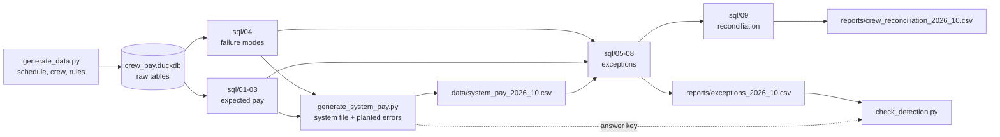

# YYZ Crew Pay Validator

Independently recalculates what every crew member should be paid for the month, reconciles it against the payroll system's month-end file, and explains the cause of every discrepancy. Anything that matches no known failure mode is routed to manual review, so every dollar of variance is accounted for.

All data is synthetic. Routes, block times, pay rates and rules are plausible but are **not** Air Canada's actual terms.

## Results (October 2026, synthetic)

| | |
|---|---|
| Crew checked | 50 (10 captains, 10 first officers, 30 flight attendants) |
| Pairings / duty days / flights | 266 / 438 / 608 |
| Expected pay | $468,930.30 |
| System pay | $461,642.09 |
| Crew with pay differences | 13 |
| Planted errors caught with correct cause | **13 / 13**, 0 missed, 0 false alarms |
| Largest unreconciled amount for any crew member | $0.02 (rounding) |

## How crew pay is credited

Crew are paid on **credit hours**, not just flying time. At each level they get the highest of several measures:

| Level | Credit = max of |
|---|---|
| Duty day | block hours (deadhead at 50%), 4-hr minimum day, duty rig (1 hr per 2 hrs on duty) |
| Trip (pairing) | sum of duty-day credits, trip rig (1 hr per 3.5 hrs away from base) |
| Month | sum of trip credits, 70-hr monthly guarantee |

These layered "max of" rules are where pay systems tend to go wrong, so the validator is built around them.

## Pipeline and data lineage



| Step | File | What it does |
|---|---|---|
| 1 | `generate_data.py` | Builds one month of crew, pairings, duty periods, flights and roster (12-hr minimum rest, no overlaps) and loads them into DuckDB using `schema.sql`. |
| 2 | `calc_pay.py` → `sql/01`–`04` | Creates SQL views for duty credit, trip credit, expected pay lines and known failure modes. |
| 3 | `generate_system_pay.py` | Simulates the payroll system's file: correct pay with 13 realistic errors planted, one per crew member. Writes an answer key the validator never reads. |
| 4 | `validate.py` → `sql/05`–`09` | Loads the system file, runs the checks and the reconciliation, and writes the reports. |
| 5 | `check_detection.py` | Scores the exceptions against the answer key. |
| 6 | `export_for_snowflake.py` | Exports every table to CSV for loading into Snowflake. `snowflake/` has the setup and check queries. |

All pay and validation logic is in SQL (`sql/`). It runs unchanged on DuckDB locally and on Snowflake. Python handles synthetic data generation, error planting and running the files. The Power BI report on top of the Snowflake views is documented in [`powerbi/`](powerbi/README.md).

**Verified on Snowflake:** loaded the same data into Snowflake, ran `schema.sql` and `sql/` unchanged, and got identical results to the local run. Compare [`snowflake/snowflake_exceptions.csv`](snowflake/snowflake_exceptions.csv) with [`reports/exceptions_2026_10.csv`](reports/exceptions_2026_10.csv).

## The checks (`sql/05`–`08`)

1. **Trip check** (`05`). Expected and system trips compared on (crew, pairing).
   - On the roster but not paid → `MISSING_TRIP`
   - Paid but not on the roster → `UNROSTERED_TRIP`
   - Credit differs → the system's number is tested against each known failure mode (`NO_DUTY_RIG`, `DEADHEAD_FULL_CREDIT`, `NO_TRIP_RIG`). If none reproduce it → `UNEXPLAINED`.
2. **Rate check** (`06`). System hourly rate vs. the crew master rate → `WRONG_RATE`, with the impact summed across all of that crew member's lines.
3. **Guarantee check** (`07`). Missing top-up → `NO_MONTHLY_GUARANTEE`. A top-up that differs only because trip credits above it are wrong → `GUARANTEE_FOLLOWS_TRIP_ERROR` (a knock-on effect, not a separate error).

`08` stacks the three checks into one `exceptions` list.

**Reconciliation control (`sql/09`).** For each crew member, (system − expected) − sum of exception impacts should be ~$0. A non-zero residual means a problem the checks didn't explain.

## Metric definitions

| Metric | Definition |
|---|---|
| Credit hours | Hours paid after applying the duty-day, trip and monthly rules above |
| Expected pay | Σ(credit hours × crew master hourly rate) from `expected_pay_lines` |
| System pay | Σ amount in the payroll system's month-end file |
| Difference | System pay − expected pay, per crew member (negative = underpaid) |
| Exception impact | $ effect of one exception: credit difference × master rate, or rate difference × credit hours |
| Explained | Σ exception impact per crew member |
| Unexplained | Difference − explained; the reconciliation control, target $0 within $0.01/line rounding |
| Detection rate | Planted errors flagged with the correct cause ÷ errors planted |

## Run it

```bash
pip install -r requirements.txt
python generate_data.py
python calc_pay.py
python generate_system_pay.py
python validate.py
python check_detection.py
```

To run it on Snowflake, follow [`snowflake/README.md`](snowflake/README.md).

## Limitations

- **The 13/13 is partly by construction.** Errors are planted with the same failure-mode logic the validator uses to diagnose them. What it demonstrates is that each known failure mode is identified correctly and that anything outside them is routed to review: the `MANUAL_ADJUSTMENT` error follows no rule and is correctly flagged `UNEXPLAINED`. Real pay data would surface failure modes not modelled here.
- **Synthetic and simplified.** There's a single base (YYZ) and one month, with trips kept inside the month (no month-end proration), and pay rules simplified from real collective agreements.
- `meal_rates` is loaded but not yet used. A per-diem check is a natural next addition.
